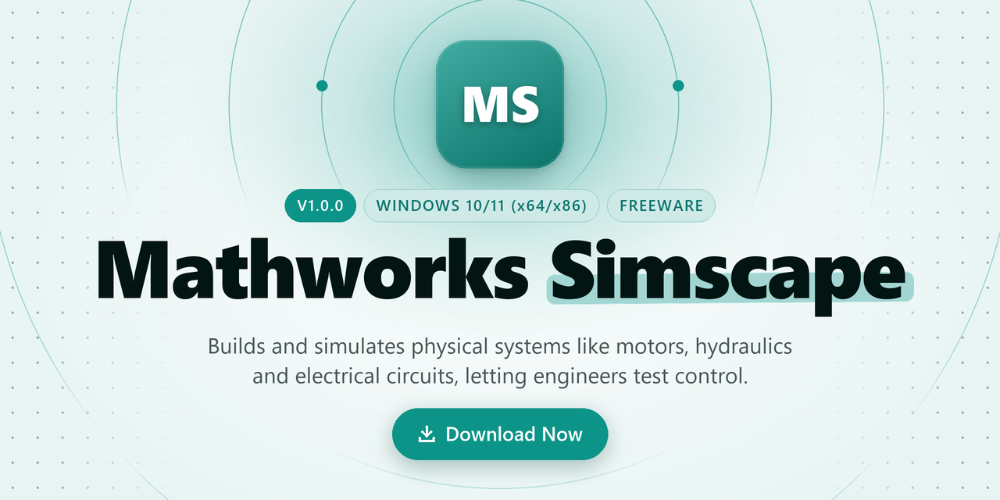

<h1 align="center">Mathworks Simscape - Physical System Modeling Suite on Windows 10/11</h1>

<p align="center"><i>Simscape lets control engineers, mechanical designers, and researchers assemble multidomain physical models (electrical, hydraulic, pneumatic, thermal, mechanical) inside Simulink and simulate them before hardware exists. This page documents Windows 10/11 requirements, configuration paths, solver and mode comparisons, keyboard shortcuts, command-line options, and known failure modes for the desktop installation.</i></p>

<p align="center">&nbsp;&nbsp;&nbsp;&nbsp;&nbsp;&nbsp;&nbsp;&nbsp;</p>

<p align="center"></p>

<p align="center">
  <a href="https://olgadesign04.github.io/mathworks-simscape/">
    <picture>
      <source media="(prefers-color-scheme: dark)" srcset="./assets/Click-dark.svg">
      
    </picture>
  </a>
</p>

<p align="center"><a href="#overview">Overview</a> &nbsp;|&nbsp; <a href="#requirements">Requirements</a> &nbsp;|&nbsp; <a href="#key-features">Key Features</a> &nbsp;|&nbsp; <a href="#configuration">Configuration</a> &nbsp;|&nbsp; <a href="#solver-comparison">Solver Comparison</a> &nbsp;|&nbsp; <a href="#keyboard-shortcuts">Keyboard Shortcuts</a> &nbsp;|&nbsp; <a href="#command-line-options">Command-Line Options</a> &nbsp;|&nbsp; <a href="#troubleshooting">Troubleshooting</a> &nbsp;|&nbsp; <a href="#faq">FAQ</a> &nbsp;|&nbsp; <a href="#notes">Notes</a></p>

## Overview

Simscape is the physical-modeling layer of the MATLAB and Simulink stack. It ships as a set of Foundation libraries plus domain add-ons, and runs as a licensed component inside the Simulink desktop environment on Windows.

### What It Does

Simscape compiles acausal component networks into differential-algebraic equations and solves them alongside your Simulink control logic in a single simulation loop. Physical ports connect components by conserving through and across variables, so you build a motor or hydraulic circuit by topology rather than by hand-deriving state equations.

### Who It Is For

Controls engineers validating plant models before ECU flashing, mechanical designers sizing actuators and transmissions, and researchers modeling thermal or electrical networks. Typical users already hold a MATLAB and Simulink license and add Simscape toolboxes for domain coverage.

### What Ships in the Build

The installer delivers the Simscape Foundation library, the Simscape Electrical, Driveline, Fluids, Multibody, and Battery add-ons (per license), the local solver and simulation engine, block libraries, and the Simscape Results Explorer. Documentation installs locally under the MATLAB root.

## Requirements

| Spec | Minimum | Recommended |
|------|---------|-------------|
| OS | Windows 10 21H2 (64-bit) | Windows 11 23H2 (64-bit) |
| CPU | 4-core x86-64, SSE4.2 | 8-core x86-64, AVX2 |
| RAM | 8 GB | 32 GB for Multibody and large networks |
| Display | 1366x768, OpenGL 3.3 | 1920x1080, discrete GPU with 4 GB VRAM |
| Storage | 30 GB free for MATLAB plus Simscape | 100 GB SSD for models, results, and cache |
| Simulink version | R2021a | R2024b or later |
| Solver dependency | bundled local solver | installed C compiler for accelerated modes |

## Key Features

* **Acausal Physical Networks** , connect components by topology and let the compiler derive the equations instead of hand-writing state-space matrices.
* **Multidomain Libraries** , mix electrical, hydraulic, pneumatic, thermal, and mechanical blocks inside one Simulink model.
* **Local Solver Acceleration** , run fixed-step and variable-step solvers on the local engine without a separate build toolchain.
* **Simscape Results Explorer** , inspect variables, energies, and solver diagnostics after a run in a dedicated viewer.
* **Real-Time and HIL Targets** , deploy validated models to Speedgoat or Simulink Real-Time hardware for hardware-in-the-loop testing.
* **Parameter Sweeps and Optimization** , drive block parameters from MATLAB scripts and Simulink Design Optimization.
* **Code Generation Path** , export plant models to C for SIL and PIL testing on the Windows host.
* **Battery and Driveline Add-Ons** , model pack-level electrochemistry and gear trains for EV and powertrain studies.

## Configuration

### Configuration files and folders

| Path | Purpose |
|------|---------|
| `%APPDATA%\MathWorks\MATLAB\R2024b\matlab.prf` | Per-user MATLAB preferences including Simscape editor and solver defaults |
| `%APPDATA%\MathWorks\Simulink\R2024b\settings.json` | Simulink environment settings inherited by Simscape models |
| `%LOCALAPPDATA%\MathWorks\Simscape\cache` | Compiled model cache and local solver intermediate files |
| `%LOCALAPPDATA%\MathWorks\Simscape\logs` | Simulation and solver diagnostic logs |
| `%PROGRAMDATA%\MathWorks\licenses` | Machine-wide license manager files and activation state |
| `%USERPROFILE%\Documents\MATLAB\Simscape` | Default working folder for user models and custom libraries |

### Key settings

| Setting | Default | Notes |
|---------|---------|-------|
| Solver type | Variable-step ode23t | Switch to fixed-step for code generation and real-time targets |
| Local solver | Off | Enable for stiff hydraulic and battery networks to cut wall-clock time |
| Max step size | auto | Set explicitly for driveline and battery models to avoid missed dynamics |
| Results Explorer autolaunch | On | Disable for batch sweeps to save RAM |
| Update channel | Release | Change to Prerelease only if you need R20xx pre-release blocks |
| Log level | warning | Raise to info or debug when diagnosing solver convergence failures |
| Telemetry | On | Opt out in MATLAB preferences under Installation and Licensing |

## Solver Comparison

| Solver | Type | Typical step cost | Best for | When to pick |
|--------|------|-------------------|----------|--------------|
| ode23t | Variable-step, trapezoidal | Moderate | General Simscape networks, electrical and thermal | Default starting point for most models |
| ode15s | Variable-step, stiff | Higher | Stiff hydraulic and battery networks | When ode23t stalls at a step or drops too small |
| ode14x | Fixed-step, extrapolation | Low per step | Real-time and HIL targets requiring fixed cadence | Speedgoat deployment and SIL/PIL testing |
| Local solver (Backward Euler) | Partitioned fixed-step | Lowest per step for stiff domains | Large Fluids and Battery networks under Simulink fixed-step | When the global solver dominates runtime |
| ode45 | Variable-step, explicit | Low for non-stiff | Mechanical Multibody with smooth dynamics | Only when the network has no stiff or algebraic loops |

## Keyboard Shortcuts

| Action | Shortcut |
|--------|----------|
| Open Simscape block library browser | Ctrl+Shift+L |
| Start simulation of current model | Ctrl+T |
| Stop simulation | Ctrl+Shift+T |
| Open Simulation Data Inspector | Ctrl+Shift+D |
| Open Simscape Results Explorer for last run | Ctrl+Shift+E |
| Zoom to fit model canvas | Spacebar |
| Rotate a Multibody block or port in the editor | Ctrl+R |
| Update diagram and recompile physical network | Ctrl+D |
| Open block parameter dialog for selection | Ctrl+U |
| Show solver diagnostics for the current run | Ctrl+Shift+S |

## Command-Line Options

| Flag | Argument | Purpose |
|------|----------|---------|
| `-batch` | `"command"` | Run a MATLAB command non-interactively then exit |
| `-r` | `"command"` | Run a command and keep the session open |
| `-nosplash` | none | Suppress the MATLAB splash screen for scripted runs |
| `-nodesktop` | none | Start without the desktop GUI; suitable for solver runs |
| `-logfile` | `path` | Write console and Simscape solver output to a log file |
| `-sd` | `folder` | Set the startup folder for model loading |
| `-singleCompThread` | none | Restrict MATLAB to one compute thread for reproducible timings |
| `-licmode` | `network` or `standalone` | Force the license acquisition mode at launch |

```bash
matlab -nosplash -nodesktop -sd "%USERPROFILE%\Documents\MATLAB\Simscape" -logfile "%LOCALAPPDATA%\MathWorks\Simscape\logs\run.log" -batch "sim('motor_control.slx'); simscape.logDiagnostics('motor_control')"
```

| Exit Code | Meaning |
|-----------|---------|
| 0 | Simulation or batch command completed successfully |
| 1 | MATLAB error or model compile failure |
| 2 | License acquisition failure |
| 3 | Solver convergence failure terminating the run |
| 4 | Invalid command-line argument |

## Troubleshooting

### Simulation stalls at the first step with a convergence warning

The solver cannot satisfy tolerances, usually from a stiff component or an unrealistically small time constant in a hydraulic or battery block.

1. Switch the solver from ode23t to ode15s in Model Settings, then rerun.
2. Enable the local solver for the affected Simscape domain.
3. Inspect the Results Explorer for near-zero time constants and raise the block inertia or capacitance.
4. Relax RelTol from 1e-3 to 1e-2 temporarily to confirm the model runs.
5. Check for algebraic loops and insert a Simscape unit delay if the network is genuinely singular.

### Model compiles slowly or memory climbs during compile

Large Multibody or Fluids networks can exhaust RAM during equation assembly, especially with the Results Explorer open in the background.

1. Close the Results Explorer and Simulation Data Inspector before rerunning.
2. Reduce logged signals to only variables you are analyzing.
3. Set the local solver cache in `%LOCALAPPDATA%\MathWorks\Simscape\cache` onto an SSD.
4. Recompile with `Ctrl+D` from a clean state after clearing the cache folder.
5. Split the model into referenced subsystems to lower peak memory.

### License checkout fails at launch

MATLAB starts but Simscape blocks fail to compile with a license error, often after a network license server change.

1. Confirm the license manager path in `%PROGRAMDATA%\MathWorks\licenses` points to the reachable server.
2. Run the activate script from the MATLAB install `bin\win64` folder with administrator rights.
3. Check `matlab -licmode network` against `standalone` to isolate the mode.
4. Verify firewall rules allow the FlexLM port from the license server.
5. Clear stale lease files under `%LOCALAPPDATA%\MathWorks\licenses` if the checkout reports an expired lease.

### Fixed-step real-time deployment overruns the sample time

Speedgoat or Simulink Real-Time runs lose real-time cadence, usually from a step size the target cannot sustain.

1. Switch the solver to ode14x and set a step size the target supports.
2. Enable the local solver for the stiff domains and offload their fixed steps.
3. Profile the model in Simulink to find blocks exceeding the per-step budget.
4. Raise the base sample rate on the real-time target if absolute timing allows.
5. Re-deploy with `-singleCompThread` disabled to confirm thread contention is not the cause.

## FAQ

### Can Simscape models be exported to run without a MATLAB license on the target?

Yes. Simulink Coder and Embedded Coder export plant models to standalone C for SIL and PIL deployment, and the resulting binary runs without a MATLAB runtime license. The export still requires a valid code generation license at build time on the Windows host.

### How do I keep Simscape block libraries in sync across a team of Windows workstations?

Install the same MATLAB and Simscape release on every workstation, keep the model repository under source control with `.slx` and `.ssc` files tracked, and pin the Simscape add-on versions in the repository README. Referenced libraries loaded from a shared folder can also enforce one canonical block set.

### Why does my hydraulic model produce different results between variable-step and fixed-step solvers?

Variable-step and fixed-step solvers integrate the physical network differently, so stiff hydraulic components with fast pressure dynamics diverge when the fixed step is too large. Set the fixed step below the fastest hydraulic time constant, enable the local solver, and validate the fixed-step results against a reconverged variable-step run before deploying to hardware.

## Notes

Simscape, MATLAB, and Simulink are trademarks of The MathWorks, Inc. This page documents the Windows 10/11 desktop installation only; block behavior and license availability depend on the installed release and your entitlement.